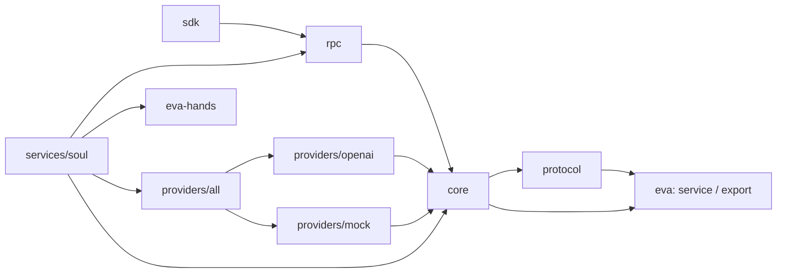

# Eva soul

Soul Евы — персонального агента, который работает постоянно. Один процесс поверх одного SQLite-файла — единственный владелец её состояния: чатов, поверхностей (surface), личностей, памяти, заметок, статистики и расхода. Всё остальное — модули: отдельные процессы, которые говорят с soul по msgpack-RPC и работают с ним тем же библиотечным API, что и код внутри soul. Сервисы (мосты в мессенджеры, MCP-обвязки) слушают unix-сокет или TCP, и soul сам звонит им по реестру под Noise; клиенты хозяина (телефон, TUI) сами звонят в soul — через unix-сокет, WebSocket или WebSocket поверх TLS. Инференс — встроенные провайдеры за трейтом `Provider`: OpenAI-совместимый (OpenRouter, либо vLLM и llama-server в диалекте `plain`) и сценарный `mock` для запуска без ключей.

Построено на фреймворке [eva](https://github.com/nerodono/eva) (конфиг, `Supervisor`, логи, время); руки — библиотека [eva-hands](https://github.com/eva-rs/hands).

## Состояние

Основные подсистемы соединены в soul. Текущие изменения проходят проверку
компиляции и точечные тесты; полная проверка релиза и интеграция с клиентом
ещё не завершены.

| Этап | Что | Статус |
|---|---|---|
| M1 | библиотечное API, схема SQLite и миграции, RPC-сервер модулей, SDK, провайдеры | готов |
| M2 | туры: диалоговый движок, хуки, `turns.*`, `chats.ingest`/`compact`/`notify` | реализован |
| M3 | память, заметки, гигиена контекста, поиск по чатам (`chats.search`) | реализован |
| M4 | каталог тулов (`tools.catalog`) и вызов тулов модулей, статистика, крон, сон, GC | реализован |
| M5 | рабочие туры: подагенты, руки, план, `ask`, разрешения и вложения | реализован |

Текущее поведение — в главах [Туры](docs/src/turns.md),
[Инструменты](docs/src/tools.md) и [Рабочие операции](docs/src/work.md).

Клиент хозяина может вручную запускать и прерывать сон, редактировать блокнот
и восстанавливать его полные снимки. Расходы доступны за точные интервалы и
календарные даты в выбранном часовом поясе; валюты учитываются раздельно.
Контракты операций — в [Библиотечном API](docs/src/api.md).

## Крейты

| Крейт | Путь | Назначение |
|---|---|---|
| `eva-protocol` | [`protocol/`](protocol/README.md) | типы операций (`Args`/`Ok`/`Err`), ошибки, проводные кадры; без I/O |
| `eva-core` | [`core/`](core/README.md) | библиотечное API: `Session`, трейты неймспейсов, `Caller`, трейт `Provider` |
| `eva-rpc` | [`rpc/`](rpc/README.md) | msgpack-кадры: клиенты по uds/ws/wss, сервисы по uds/tcp под Noise (дозвон soul); сервер-диспетчер, клиентская `RpcSession` |
| `eva-sdk` | [`sdk/`](sdk/README.md) | модуль soul: сервис слушает звонок soul, клиент подключается сам; смена соединения, тулы, события, хуки |
| `eva-provider-openai` | [`providers/openai/`](providers/openai/README.md) | OpenAI-совместимый Chat Completions |
| `eva-provider-mock` | [`providers/mock/`](providers/mock/README.md) | сценарный провайдер для тестов и смоука |
| `eva-providers` | [`providers/all/`](providers/all/README.md) | `ProviderConfig` под тегом `kind`, диспетчер `AnyProvider` |
| `eva-soul` | [`services/soul/`](services/soul/README.md) | бинарь и библиотека soul |

Зависимости (стрелка — «зависит от», транзитивные рёбра опущены); обратных рёбер нет:



## Сборка и запуск

Сборка — только через Nix: у системного `cargo` нет нужного линкера.

```sh
nix develop                                # devShell: toolchain, sqlite, cargo-insta, mdbook
nix develop -c cargo test --workspace      # тесты
nix build .#eva-soul                     # бинарь: ./result/bin/eva-soul
nix develop -c mdbook build docs           # книга: docs/book/index.html
nix develop -c mdbook serve docs           # книга с живой пересборкой
```

```sh
eva-soul --config eva.yaml [--config more.yaml …]
```

Форматы — YAML, JSON, TOML (по расширению); несколько `--config` сливаются, поздний сильнее. Переменные `EVA_…` сильнее файлов, вложенность — через `__`: `EVA_DB__READERS=8` — это `db.readers`.

## Минимальный конфиг

```yaml
system:
  state_dir: /var/lib/eva            # БД, blob'ы, сокет, песочницы модулей
llm:
  providers:
    router:
      kind: openai                   # base_url по умолчанию — OpenRouter
      api_key: {file: /run/secrets/router-key}
  default_model: vendor/model        # id модели из каталога провайдера
modules:
  listen:
    - uds: modules.sock              # относительный путь — от state_dir
  tokens:                            # клиенты хозяина звонят сами, с токеном
    phone:                           # ключ записи — id модуля
      token: {file: /run/secrets/eva-phone}
  services:                          # сервисы слушают, soul звонит им сам
    bridge:
      address: uds:///run/eva-bridge/module.sock   # или tcp://host:port
      key: {file: /run/secrets/eva-bridge}         # тот же секрет — module.key у модуля
```

Без ключей: `llm: {providers: {mock: {kind: mock}}, default_model: mock}`.

До запуска создайте файл персоны `persona.md` в `system.state_dir`. Его путь
задаёт `context.persona_file`; отсутствие или нечитаемый файл останавливает старт.

Секреты (`llm.providers.*.api_key`, `modules.tokens.*.token`, `modules.services.*.key`, `hands.endpoints.*.key`, `module.token` и `module.key` модуля на SDK) — `{file: /путь}` или `{plaintext: "…"}`. Читаются один раз на старте, хвостовой перевод строки срезается; нечитаемый секрет — отказ старта с путём ключа. Форму `plaintext` держите вне файлов, которые видят другие. Id `soul`, `system`, `local` зарезервированы.

## NixOS

Флейк — `eva.lib.mkServiceFlake` фреймворка: `nixosModules.default` даёт `services.eva-soul`, где несекретное — в `settings`, а секреты — `secrets."<ключ>" = <файл>`. systemd отдаёт файл сервису через `LoadCredential`, в конфиг встаёт `{file = "/run/credentials/eva-soul.service/<ключ>";}`. Пользователя `eva-soul` и группу `eva` модуль не создаёт — их объявляет хост.

```nix
users.users.eva-soul = { isSystemUser = true; group = "eva-soul"; };
users.groups = { eva-soul = { }; eva = { }; };

services.eva-soul = {
  enable = true;
  settings = {
    llm.providers.router.kind = "openai";
    llm.default_model = "vendor/model";
    modules.services.bridge.address = "uds:///run/eva-bridge/module.sock";
  };
  secrets = {
    "llm.providers.router.api_key" = "/run/secrets/router-key";
    "modules.tokens.phone.token" = "/run/secrets/eva-phone";
    "modules.services.bridge.key" = "/run/secrets/eva-bridge";
  };
};
```

`settings` попадают в мирочитаемый Nix store, поэтому сборка отказывает, если секрет (`llm.providers.*.api_key`, `modules.tokens.*.token`, `modules.services.*.key`, `hands.endpoints.*.key`) стоит в `settings` формой `plaintext`, и если ключ `secrets` не совпадает ни с одним из этих полей. Права файлов задаёт не код, а модуль: база (в ней ключи сервисов из `modules.add`), blob'ы и песочницы — только пользователю soul (`StateDirectoryMode = 0700`, `UMask = 0077`); soul сам связывает сокет клиентов `/run/eva-soul/modules.sock` в своём `RuntimeDirectory`, и при таком `UMask` он доступен только пользователю soul; сервисы машины слушают `/run/eva-<id>/module.sock` с группой `eva`, soul в ней состоит. Подробно — [Быстрый старт](docs/src/quickstart.md#nixos).

## Документация

Книга (mdBook) — в [`docs/`](docs/src/SUMMARY.md):

- [Введение](docs/src/introduction.md)
- [Быстрый старт](docs/src/quickstart.md)
- [Архитектура](docs/src/architecture.md)
- [Конфигурация](docs/src/config.md)
- [Библиотечное API](docs/src/api.md)
- [Протокол модулей](docs/src/protocol.md)
- [SDK модулей](docs/src/sdk.md)
- [Провайдеры инференса](docs/src/providers.md)
- [Безопасность](docs/src/security.md)
- [Разработка](docs/src/development.md)
- [Дорожная карта](docs/src/roadmap.md)

Правила для агентов, работающих в репозитории, — [`AGENTS.md`](AGENTS.md).
