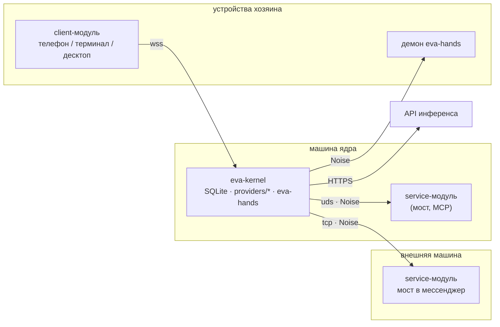
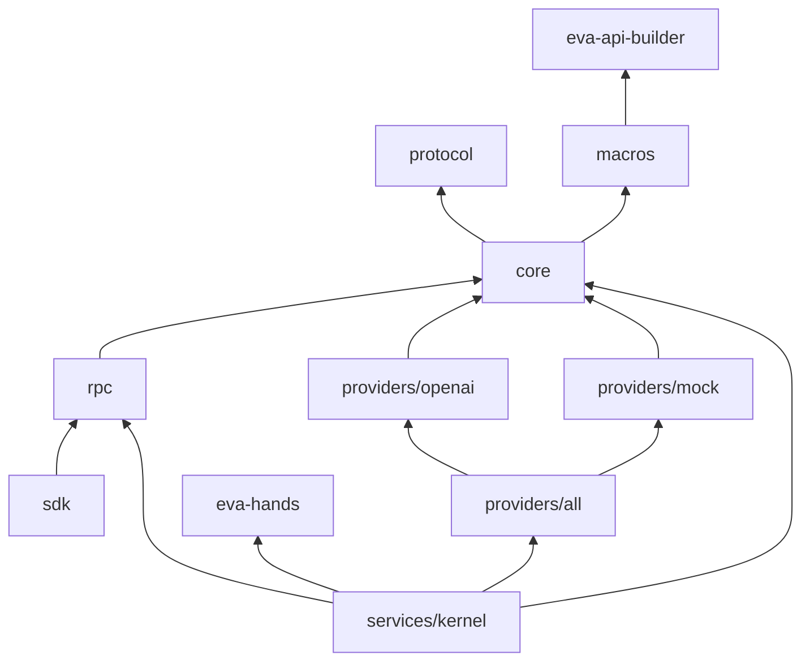
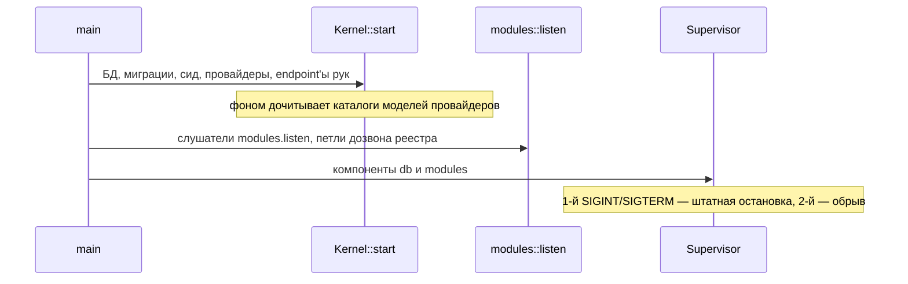

# Архитектура

## Процессы и границы доверия



- Сервисные модули адреса ядра не знают: они слушают, ядро само набирает записи реестра `modules.services` / `modules.add` (Noise с PSK записи). Клиенты хозяина за NAT и приходят-уходят, поэтому звонят в ядро сами, с токеном. Одно соединение — одна сессия — один вызывающий (caller).
- Вид прав определяет соединение: набранный ядром — `service`, пришедший с токеном — `client`. Id модуля — ключ записи реестра или токена; имени в `hello` нет. Транспорт лишь выводит из соединения caller'а, решения принимает библиотека.
- Провайдеры инференса скомпилированы в бинарь ядра. Внешний провайдер-модуль допускается только как запасной вход и только если конфиг явно его называет.
- Руки (исполнение `fs_*`/`shell_*` на машине) — библиотека [`eva-hands`](https://git.desu.church/eva/hands) внутри ядра: локально или через демон на другой машине. Модули рук не исполняют. Инструменты рук включаются в M5.

## Крейты

| Путь | Крейт | Содержит |
|---|---|---|
| `protocol/` | `eva-protocol` | Типы данных, операции `requests/<ns>.rs` (`Args`/`Ok`/`Err`), коды ошибок, wire-кадры; без I/O |
| `macros/` | `eva-kernel-macros` | Список операций `endpoints!` на `eva-api-builder` фреймворка: трейты неймспейсов и X-макро `for_each_op!` |
| `core/` | `eva-core` | `Session`, трейты неймспейсов и `for_each_op!` из списка операций, `Caller`, трейт `Provider` |
| `rpc/` | `eva-rpc` | Кадры msgpack, транспорты клиентов uds/ws/wss и сервисов uds/tcp под Noise, симметричный пир, серверный диспетчер, `RpcSession`, `ModuleProvider` |
| `sdk/` | `eva-sdk` | `Module` → `Listening` (сервис слушает ядро) / `Connected` (клиент звонит сам), `Kernel = Session<LiveSession>` (переживает смену соединения) |
| `providers/openai`, `providers/mock` | `eva-provider-*` | `impl Provider` одного вендора |
| `providers/all/` | `eva-providers` | `ProviderConfig` с тегом `kind`, диспетчер `AnyProvider`, `build` |
| `services/kernel/` | `eva-kernel` | Библиотека и бинарь ядра |

Зависимости направлены в одну сторону:



Строки конкретных вендоров и поверхностей живут только в `providers/*`: ядро не знает ни одного вендора и ни одной поверхности по имени, это проверяет тест `vendor_lint`.

## Библиотечное API — единственная реализация

Основной интерфейс ядра — Rust-библиотека. Операция — это `namespace.op` с типами `Args`/`Ok`/`Err` в `eva-protocol`; вызов одинаков внутри ядра и в модуле:

```rust
let mut session = kernel.make_session(Caller::Kernel).await?;
let surfaces::get::Ok { surface } = session
    .surfaces()
    .get()
    .call(surfaces::get::Args { surface: "local".into() })
    .await?;
```

- `Session<S>` — неймспейс на домен, метод на операцию. 20 неймспейсов: `surfaces`, `folders`, `chats`, `turns`, `persons`, `memory`, `notes`, `tools`, `models`, `cron`, `sleep`, `agents`, `stats`, `modules`, `hands_grants`, `blobs`, `inference`, `fs`, `sqlite`, `kv`.
- Операции перечислены один раз — `endpoints!` в `macros/src/lib.rs`. Из списка получаются трейты неймспейсов, методы `Session` и X-макро `for_each_op!`, по которому собраны RPC-диспетчер, RPC-клиент и SDK. Шаг любой операции — `CallStep` фреймворка `eva`, вызов — `.call(args)`.
- Вид операции — флаг в списке: без флага — чтение; `mutating` — повтор того же запроса в окне идемпотентности отдаёт сохранённый ответ; `stream` — `Ok` есть поток `Items`; `upload` — `Args` несёт тело `ByteStream`.
- RPC-метод — `<namespace>.<op>`; msgpack-RPC и будущие инструменты модели — обёртки над той же операцией, а не отдельные реализации. Контрактный тест проверяет, что вызов в процессе и через UDS даёт побайтно равные ответы.
- Внутри `eva-kernel` код разложен по слоям: `handling/` — хендлер на операцию, `impls/` — namespace-трейты над хендлерами (строка `project!` на операцию), `state/policy/` — авторизация, `db/` — весь SQL, `convert/` — строки БД в типы протокола, `subsystems/` — компоненты `Supervisor`.

Каталог операций — в главе [Библиотечное API](api.md), wire-формат — в [Протоколе модулей](protocol.md).

## Session, Caller, Policy

`Caller` — кто вызывает сессию:

| Caller | Кто | Может |
|---|---|---|
| `Kernel` | Само ядро: инструменты модели, крон, сон, GC, уведомления | Всё, кроме песочницы `fs`/`sqlite`/`kv` и `surfaces.create` (у ядра нет модуля) |
| `Client { module }` | Клиент хозяина: звонит сам, с токеном | Всё, что может хозяин |
| `Service { module }` | Служебный модуль, которого набрало ядро по реестру | Только объекты surface, которые создал сам, плюс свои `fs`/`sqlite`/`kv` |

`Policy` — единственное место авторизации, по файлу на домен в `state/policy/`. Хендлер спрашивает её до любой работы, если право не зависит от объекта (`owner`, `kernel`, `module`), и сразу после загрузки объекта, если зависит, — в обоих случаях раньше первой записи. На чужой чат, папку, личность, blob сервис получает `forbidden`, как и на несуществующий, чтобы ответ не выдавал, что объект есть; исключение — `surfaces.get`/`surfaces.update`: несуществующий id surface — `not_found` любому caller'у, чужой — `forbidden`. Для `Service` фильтр видимости стоит в `WHERE` запроса, а не в пост-фильтре. Подробности — в главе [Безопасность](security.md).

## Модель данных

### Surface, папки, чаты

- **Surface** — лицо Евы, канал, в котором живут чаты. Модуль её не объявляет, а создаёт операцией `surfaces.create {id, name, rules?}`; ядро записывает создателя в `surface.module`, для него повторный вызов идемпотентен. Встроенные surface засевает ядро: `local` (клиенты хозяина; несколько `client`-модулей видят одни и те же чаты) и `system` (крон, сон, уведомления).
- Реестра обслуживания нет: ядро выводит его из живых сессий. Свою surface обслуживает сессия создателя, `local` — каждая сессия `client`, `system` — никто. Кнопки pending-запросов в чате (M5) доступны, если хоть одна обслуживающая сессия объявила capability `ask`.
- **Папка** — группа чатов внутри surface. У каждой surface есть встроенные `Unsorted` и `agents`, у `system` ещё `cron`, `sleep`, `notify`. Встроенные папки не удаляются и не переименовываются.
- **Чат** — последовательность сообщений с одной историей. `kind`: `ephemeral` (его убирает GC) или `persistent`, переход только в одну сторону. Флаги `pinned`, `alerted`, `undeletable`, мягкое удаление `deleted_at`, внешний адрес `alias {external_id, kind: direct|group|channel}`, `project`, `workdir`, `workdir_on` (имя endpoint'а рук).
- Сообщение хранит блоки `text`, `image {blob, media_type}`, `file {blob}`. Байты вложений лежат в blob-store (`<state_dir>/blobs`), в истории — только ссылки.

### Наследование настроек и доверия

`trusted`, `model`, `effort`, `thinking`, `compact_at` задаются как `Option` на surface, папке и чате. Эффективное значение — первое заданное снизу вверх:

```text
chat.trusted ?? folder.trusted ?? surface.trusted ?? false
```

Эффективный trust ядро вычисляет при чтении и отдаёт в поле `trusted_chat`. Менять эти поля может только хозяин (`Kernel` или `Client`).

### Личности

- **Person** — человек: `id` вида `p<N>`, `name`, `master`, `whitelisted` (эффективно `whitelisted ∨ master`).
- **Identity** — адрес личности на поверхности: `(surface, external_id)`, `handle`, `name`.
- `p0` — служебная личность ядра `system`. Личность хозяина засевается из `chats.persons.master` (список `{surface, external_id, module?}`) с именем `chats.persons.master_name`; `module` привязывает surface адреса к модулю, и создать её может только он.
- `master` — положительный факт из БД: из провода он не выводится, неизвестный отправитель никогда не хозяин.
- `persons.resolve` сопоставляет адрес с личностью или заводит новую; `merge`, `rename`, `whitelist` — операции хозяина.

### Прочие таблицы

Схема создана целиком уже в M1, хотя часть таблиц наполнят следующие этапы.

| Группа | Таблицы | Назначение |
|---|---|---|
| Лог чатов | `segments`, `events`, `messages`, `tool_results`, `token_ratios` | Сегменты истории между компакциями и append-only лог событий |
| Инструменты | `tools`, `tool_groups`, `tool_placements`, `tool_overrides`, `tool_pins`, `chat_warm_sets`, `chat_loaded_tools` | Реестр и дерево групп, видимость в чатах |
| Память | `memory`, `memory_fts`, `memory_archive`, `memory_link`, `embed_cache` | Межчатовые записи с `visibility ∈ {public, trusted, private}`, полнотекстовый индекс, архив версий, эмбеддинги |
| Заметки | `chat_notes`, `notes_state` | Блокнот чата |
| Чаты и личности | `surfaces`, `folders`, `chats`, `chat_aliases`, `persons`, `identities`, `chat_speech`, `chat_speech_fts`, `chat_speech_vec` | Сущности выше и индекс поиска по чатам |
| Модули | `modules`, `module_services`, `module_tokens`, `module_kv`, `module_kv_usage` | Состояние модулей, сервисы из `modules.add` (адрес и ключ как есть: ядро само им дозванивается — база и её бэкапы секрет), выданные токены клиентов (только хэши), KV модулей и его расход по модулю (ведут триггеры) |
| Рабочие туры | `agents`, `agent_messages`, `pending`, `hands_grants`, `chat_plan`, `blobs` | Подагенты, ожидания ответа, гранты рук, план, вложения |
| Планировщики | `cron_jobs`, `cron_runs`, `sleep_runs`, `sleep_phase_runs`, `gc_runs` | Крон, фазы сна, сборка мусора |
| Статистика | `tool_stats`, `chat_stats`, `spend`, `health_stats` | Вызовы инструментов, расход инференса, счётчики здоровья |
| Служебное | `kernel_meta`, `schema_migrations` | Метаданные ядра, применённые миграции |

## SQLite

- Один файл: `db.path`, по умолчанию `<state_dir>/eva.sqlite`. Режим WAL, `foreign_keys = on`, `synchronous = NORMAL`, `temp_store = MEMORY`; на новом файле — `auto_vacuum = INCREMENTAL`. Таблицы `STRICT`, перечисления закреплены `CHECK`.
- **Один писатель** за асинхронным мьютексом и **пул читателей** (`db.readers`, по умолчанию 4) в режиме `query_only`. Каждый запрос выполняется в `spawn_blocking`, поэтому async-потоки не блокируются.
- **Миграции** встроены в бинарь (`0001_init`, `0002_module_kv_usage`, `0003_module_services`), пронумерованы и применяются только вперёд. У каждой — blake3-чексумма; применённые миграции обязаны быть префиксом встроенных с теми же суммами, иначе ядро не стартует (бинарь старее базы, файл миграции правили задним числом или это чужая база).
- **Сид** на каждом старте, идемпотентный: `local`, `system`, их папки, `p0` и личность хозяина из конфига.
- На старте все модули помечаются `offline` (сессии прошлого процесса мертвы), модули, которые молчат дольше `modules.offline_forget` (по умолчанию 7 дней), помечаются `forgotten` — на старте и дальше раз в час. На остановке, после закрытия сессий модулей, — `PRAGMA optimize` и `wal_checkpoint(PASSIVE)`.

## Процесс и Supervisor

Бинарь построен на фреймворке [`eva`](https://git.desu.church/VienDesu/eva): `eva::cli::App` собирает конфиг из файлов и `EVA_*`, `Supervisor` запускает компоненты, у каждого своя секция конфига.



| Компонент | Секция | Что делает в M1 |
|---|---|---|
| `db` | `db` | Держит базу до остановки; сбрасывает WAL, когда компонент `modules` закончил, потому что сессии модулей пишут в базу до своего закрытия |
| `modules` | `modules` | Петли дозвона записей реестра (Noise по PSK записи), слушатели клиентов (handshake по токену), RPC-сервер над библиотекой, живые сессии, провайдеры-модули, рассылка событий |

Слушатели поднимаются до запуска компонентов: занятый сокет роняет процесс целиком, а не одну подсистему (сокет менеджера служб с тем же адресом берётся готовым). Петли дозвона не сдаются: недоступный сервис — не ошибка старта, а `offline` в `modules.list`. `Kernel<C>` параметризован набором компонентов (`Components`: часы и RNG, БД, провайдер, руки), поэтому тесты подменяют время, БД с инъекцией отказов и провайдер `mock`. Компоненты туров, инструментов, памяти, крона, сна и GC появятся на этапах M2–M5 ([Дорожная карта](roadmap.md)).
