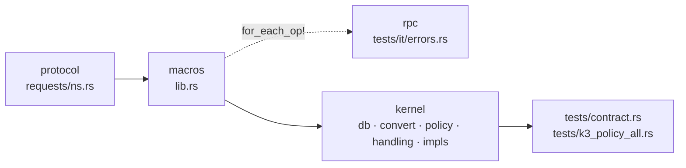

# Разработка

## Раскладка репозитория

| Путь | Крейт | Содержит |
|---|---|---|
| `protocol/` | `eva-protocol` | типы данных, операции `requests/<ns>.rs` (`Args`/`Ok`/`Err`), доменные ошибки `errors/<ns>.rs`, wire-кадры и handshake; без I/O |
| `macros/` | `eva-kernel-macros` | список операций `endpoints!`: трейты неймспейсов и X-макро `for_each_op!` |
| `core/` | `eva-core` | `Session`, `CallStep`, трейты неймспейсов и `for_each_op!` из списка операций, `Caller`, трейт `Provider`, `prelude` |
| `rpc/` | `eva-rpc` | кадры msgpack, транспорты uds/ws/wss, HTTP-мост JSON-RPC, симметричный пир, сервер-диспетчер, `RpcSession`, `ModuleProvider` |
| `sdk/` | `eva-sdk` | `Module` → `Listening` / `Connected`: SDK для модулей |
| `providers/openai/`, `providers/mock/` | `eva-provider-*` | `impl Provider` одного вендора |
| `providers/all/` | `eva-providers` | `ProviderConfig` под тегом `kind`, `AnyProvider`, `build` |
| `services/kernel/` | `eva-kernel` | библиотека ядра и бинарь `eva-kernel` |
| `docs/` | — | эта книга (mdBook) |
| `flake.nix` | — | `eva.lib.mkServiceFlake` фреймворка: пакет, devShell, NixOS-модуль |

Внутри `services/kernel/src/`:

| Каталог | Что там |
|---|---|
| `config/` | секции конфига |
| `db/` | весь SQL; `db/migrations/NNNN_name.sql` и список `MIGRATIONS` в `db/migrate.rs`; VFS квоты модульных баз `db/quota_vfs.rs` |
| `convert/` | строки БД → типы протокола |
| `state/policy/` | авторизация, файл на домен |
| `handling/` | хендлер на операцию, файл на домен; потолки строк — `handling/text.rs` |
| `impls/` | реализации трейтов неймспейсов поверх хендлеров |
| `subsystems/` | компоненты супервизора (`modules`: слушатели, handshake, живые сессии) |
| `providers.rs`, `registry.rs` | провайдеры ядра и реестр моделей |

## Сборка и тесты

Всё собирается и запускается только внутри devShell флейка:

```sh
nix develop -c cargo check --workspace
nix develop -c cargo test -p eva-provider-openai
nix build .#eva-kernel        # ./result/bin/eva-kernel
nix develop -c mdbook build docs   # книга в docs/book
```

Почему devShell обязателен:

- у системного `cargo` нет нужного линкера и системных библиотек, сборка вне shell падает на линковке;
- toolchain (rustc, clippy, rustfmt, rust-analyzer) закреплён флейком фреймворка [`eva`](https://git.desu.church/VienDesu/eva) — результаты `fmt` и `clippy` совпадают у всех;
- в shell есть `sqlite` (смотреть базы), `cargo-insta` (снапшоты), `mdbook` и `mdbook-mermaid` (книга).

`nix build` собирает через crane и прогоняет тесты в `checkPhase`; в исходники сборки попадают `*.snap` и `*.sql`, иначе снапшот- и схемные тесты сравнивали бы с пустотой. Флейк берёт исходники из git, поэтому новый файл, ещё не добавленный в индекс (`git add`), в сборку не попадёт, хотя `cargo` в devShell его видит.

Книга собирается `mdbook build docs` в devShell; диаграммы — блоки `mermaid`. Меняешь поведение — правь соответствующую главу в том же изменении.

Параллельные сборки в одном дереве ждут друг друга (`Blocking waiting for file lock`) — это нормально. `cargo clean` не нужен.

## Гейты качества

Перед сдачей изменения должны проходить все три:

```sh
nix develop -c cargo fmt --all
nix develop -c cargo clippy --workspace --all-targets -- -D warnings
nix develop -c cargo test --workspace
```

Манифесты и `Cargo.lock` меняются только при прямой необходимости.

## Правила слоёв

Зависимости направлены в одну сторону, обратных рёбер нет; схема — в главе [Архитектура](architecture.md#крейты).

| Что | Где и только там |
|---|---|
| Список операций и их вид | `macros/src/lib.rs` |
| SQL | `services/kernel/src/db/` |
| Хендлеры операций (`#[eva::endpoint]` + `#[fastrace::trace]`) | `services/kernel/src/handling/` |
| Авторизация | `services/kernel/src/state/policy/`; транспорт лишь выводит `Caller` из токена |
| Строки БД → типы протокола | `services/kernel/src/convert/` |
| Строки вендоров и поверхностей | `providers/*` |

Раскладку SQL, хендлеров и `Caller` сторожит `services/kernel/tests/k3_layer_lint.rs`.

Прочие правила:

- Одна реализация операции: RPC-метод и тул — обёртки над ней.
- Авторизация стоит в начале хендлера: общие проверки (`owner()`, `module()`) идут до любой работы, проверки по объекту — сразу после его загрузки и до первой записи. На чужой объект хендлер отвечает `forbidden`, а не `not_found`, чтобы не выдавать факт существования.
- `Aux::Unavailable` означает недоступность нужного компонента или неподходящее текущее состояние. Маркеры незавершённых этапов в ответах операций не используются.
- Строки, которые вызывающий пишет в базу ядра, ограничиваются потолками из `handling/text.rs`.
- Миграции только вперёд: применённые миграции должны быть префиксом встроенных с теми же blake3-чексуммами, иначе ядро отказывается стартовать. Правка схемы — новый файл `NNNN_name.sql` и строка в `MIGRATIONS`, не правка старого.

### Стиль кода

- Фреймворк `eva`: `#[data]` на все типы данных (serde в `snake_case`), `eva::time`, `log` с ключами (`log::info!(k = v; "msg")`), `eva::cli::App` и `Supervisor` в бинарях.
- Никаких `unwrap`/`expect` на данных провода, БД и сети; паника — только нарушенный инвариант.
- Идентификаторы, логи, промпты — на английском. Комментарии — на русском, одна фраза «почему», только неочевидное, без истории изменений.

## Новая операция



1. **protocol.** В `protocol/src/requests/<ns>.rs` — модуль операции с `Args`, `Ok`, `Err` (все `#[data]`) и `code!(Err => [...])`, сопоставляющим вариант ошибки коду провода. Новые доменные ошибки — в `protocol/src/errors/<ns>.rs` со своим `code!`.
2. **macros.** Добавить операцию в `endpoints!` в `macros/src/lib.rs` на её место в неймспейсе, с флагом вида: без флага — чтение, `mutating` — мутация, `stream` — поток (`Ok = Items<Item, Err>`), `upload` — загрузка (`Args { meta, body }`). Отсюда метод трейта неймспейса, строка `NAMESPACES` и строка `for_each_op!`. Флаг не сверяет ни один тест: мутация без `mutating` пройдёт мимо окна идемпотентности, и SDK повторит её после реконнекта.
3. **rpc.** Только строка в `rpc/tests/it/errors.rs`: варианты `Err` операции и их коды. Клиентская сессия, таблица диспетчера и тестовое ядро `rpc/tests/it/kernel.rs` — колбэки над `eva_core::for_each_op!`, форму задаёт флаг (`mutating` — окно идемпотентности, `stream` — `Items` кадрами потока, `upload` — `Meta` в `params` и тело чанками). Сверку с `NAMESPACES` держит `rpc/tests/it/methods.rs`. SDK получает метод автоматически.
4. **kernel:**
   - запросы — в `db/<ns>.rs`;
   - преобразование строк — в `convert/`;
   - правило доступа — в `state/policy/<ns>.rs`;
   - хендлер `pub async fn Op<C: Components>(state: &mut State<C>, args) -> Response<Ok, Err>` — в `handling/<ns>.rs`; у потока `Ok` — `Items`, у загрузки тело — `args.body`;
   - строка `fn op() = h::Op;` в блоке `project!` — в `impls/<ns>.rs`; без неё трейт неймспейса не соберётся.
5. **Тесты.** Строка в `services/kernel/tests/contract.rs`: операция проходит и в процессе (`Kernel<Test>`), и через `eva-sdk` по настоящим сокетам (клиент звонит на UDS ядра, сервис ядро набирает по uds и tcp под Noise), а ответы сверяются побайтно в msgpack. Строка в матрице `services/kernel/tests/k3_policy_all.rs`: исход операции для каждого вызывающего (ядро, клиент, свой сервис, чужой сервис, сервис против `local`/`system`). Поведение и политика — в доменном файле `services/kernel/tests/<ns>.rs`.

Тестовый харнесс (`services/kernel/tests/common/`) собирает `Kernel<Test>` на временном каталоге: часы двигает тест, провайдер — `mock`, руки — `Hands::local` в песочнице; отказы БД и рук включаются флагом. Набор подменяемых компонентов задаёт трейт `Components` (`Real` — боевой).

## Vendor lint

`services/kernel/tests/vendor_lint.rs` обходит крейты `protocol`, `macros`, `core`, `rpc`, `sdk`, `services/kernel` — код, тесты, SQL, манифесты, снапшоты — и падает на любом вхождении (без учёта регистра) имён вендоров и поверхностей из списка-запрета: `anthropic`, `openai`, `openrouter`, `claude`, `gemini`, `mistral`, `ollama`, `telegram`, `whatsapp`, `discord`, `slack`. Такие строки допустимы только в `providers/*`. Ядро различает провайдеров и поверхности по данным (`kind`, id), а не по именам в коде.

## Снапшот-тесты

Снапшоты — `insta`, файлы `tests/snapshots/*.snap` рядом с тестами:

| Тест | Что фиксирует |
|---|---|
| `providers/openai/tests/request.rs` | тела `POST /chat/completions`: диалекты, тулы, breakpoint'ы, effort, структурированный вывод, картинки |
| `providers/openai/tests/models.rs` | декларации моделей из фикстуры каталога |
| `services/kernel/tests/schema.rs` | дамп схемы SQLite после миграций |

```sh
nix develop -c cargo insta test -p eva-provider-openai
nix develop -c cargo insta review
```

Изменившийся вывод пишется в `*.snap.new`; принимать его — только если изменение намеренное. Снапшоты коммитятся вместе с кодом.

Кроме снапшотов, в `providers/openai/tests/prefix.rs` — property-тест (`proptest`): рендер префикса диалога совпадает с началом рендера всего диалога, кроме части с хвостовым breakpoint'ом короткого запроса, — на этом держится кэш промпта.
