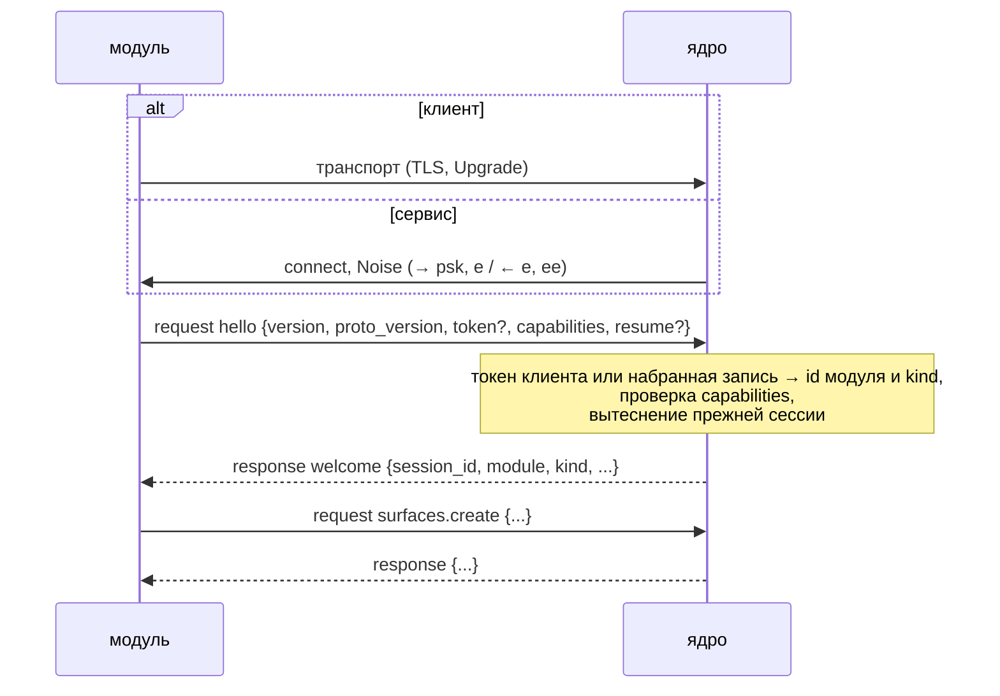
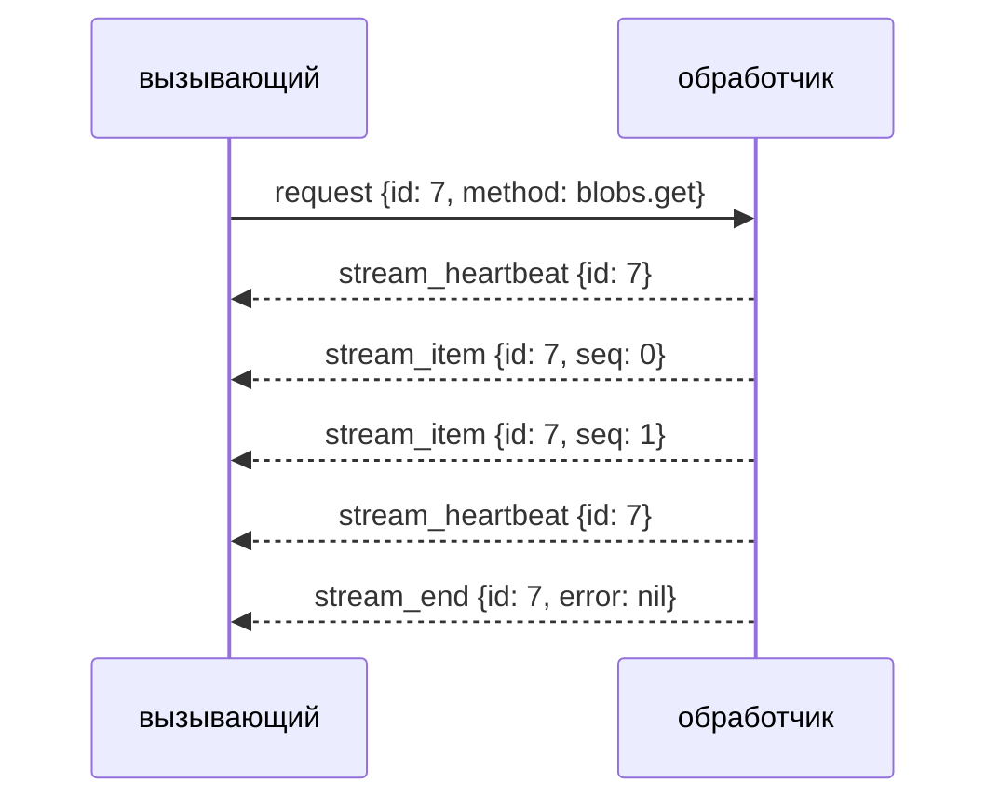

# Протокол модулей

Модуль — отдельный процесс, который подключается к ядру и говорит с ним по симметричному мультиплексированному RPC поверх msgpack. Глава описывает провод для автора модуля на любом языке; на Rust то же самое делает [`eva-sdk`](sdk.md). Каталог операций — в [Библиотечном API](api.md), значения таймингов и лимитов — ключи секции `modules` из [Конфигурации](config.md#транспорт); ниже везде указаны их умолчания.

## Транспорты

Кто звонит, задаёт вид модуля:

| Вид | Соединение | Транспорты | Аутентификация |
|---|---|---|---|
| сервис (мост мессенджера, MCP) | ядро → модуль | uds, tcp — оба под Noise | общий PSK |
| клиент (телефон, TUI) | модуль → ядро | uds, ws, wss | токен в `hello` |

Сервис адреса ядра не знает — только слушает. Клиенты за NAT и приходят-уходят, поэтому звонят сами. Все транспорты несут одинаковые кадры.

### Слушатель ядра (клиенты)

| Транспорт | Слушатель ядра | Адрес у модуля | Кадрирование |
|---|---|---|---|
| Unix-сокет | `{uds: <путь>, mode?, group?}` | `uds:///run/eva-kernel/modules.sock` (или `unix://`) | `u32` big-endian длина, затем msgpack-кадр |
| WebSocket | `{ws: <addr:port>}` | `ws://host:port/v1/modules` | один binary-message — один кадр |
| WebSocket + TLS | `{wss: <addr:port>, tls: {cert, key}}` | `wss://host:port/v1/modules` | то же поверх TLS |

- WebSocket-Upgrade принимается только на пути `/v1/modules`, иначе HTTP 404. У клиента SDK пустой путь дополняется до `/v1/modules`.
- Text-message в WebSocket — нарушение протокола, соединение закрывается. Ping/pong WebSocket-уровня протокол не использует — у него свой `ping`.
- Кадр больше `max_frame` (16 MiB) закрывает соединение с `invalid_params`.
- Закрытие с причиной: перед закрытием сокета пир шлёт уведомление `close` (см. ниже). WebSocket дополнительно передаёт причину close-кадром: код 1008 и текст до 123 байт; штатное закрытие — код 1000 без текста. У uds и Noise close-кадра нет — причину несёт только `close`.

### Сервисное соединение (Noise)

Сервис слушает `{uds: <путь>, mode?, group?}` или `{tcp: <addr:port>}`; ядро набирает его по адресу `uds:///<абсолютный путь>` или `tcp://<host>:<port>` (`host` резолвится на каждой попытке, TCP — с `nodelay`).

- Noise `Noise_NNpsk0_25519_ChaChaPoly_BLAKE2s`: ядро — initiator, модуль — responder. Handshake — два сообщения с пустым payload: `→ psk, e`, `← e, ee`.
- PSK = HKDF-SHA256(ikm = секрет без хвостовых `\n`/`\r`, без salt, info = `eva-module psk v1`) → 32 байта. Секрет — высокой энтропии: NNpsk0 с угадываемым секретом подбирается офлайн по перехваченному handshake.
- Сообщение Noise на проводе — `u16` big-endian длина и шифротекст до 65535 байт (16 из них — тег AEAD), открытого текста в сообщении — до 65519 байт. Внутри расшифрованного потока — кадрирование uds (`u32` длина + msgpack-кадр); кадр длиннее сообщения идёт несколькими.
- Чужой PSK: модуль не расшифрует первое сообщение и закрывает сокет без ответа — ядро видит обрыв.
- Модуль закрывает сокет, молчащий вместо Noise дольше `handshake_timeout`.

## Кодировка

Всё — msgpack **с именами полей** (карты, не позиционные массивы). Позиционная форма ломает разбор untagged-типов и пропуск незнакомых полей, поэтому другой нет.

| Что | Форма на проводе |
|---|---|
| Структура | карта `{имя_поля: значение}`; опциональное поле — `nil` или отсутствует |
| Enum | имена вариантов в `snake_case`, внешний тег: `"continue"` для варианта без данных, `{"cancel": {"reason": "…"}}` для варианта с данными |
| `Bytes` | msgpack `bin` |
| `Timestamp` | `u64` — наносекунды Unix-эпохи |
| `Date` | `u16` — дни от Unix-эпохи |
| Длительность | строка humantime: `"15s"`, `"1500ms"`, `"10m"` |
| Версия протокола | строка `"MAJOR.MINOR"` |
| id | целочисленные — число (на вход можно и `"42"`, `"c42"`), строковые — строка ([Идентификаторы](api.md#идентификаторы)) |

Разбор двухшаговый: `params`, `result`, `item` и `data` кадра — **`bin` с отдельным msgpack-документом** внутри, а не вложенная карта. Получатель сначала разбирает кадр, потом payload по методу. Незнакомый payload роняет только свой вызов, а не соединение.

## Кадры

Кадр — карта с одним ключом, имя которого — вид кадра:

| Вид | Поля | Смысл |
|---|---|---|
| `request` | `id: u64`, `method: str`, `params: bin` | Вызов; шлют оба пира |
| `response` | `id`, `result: bin?`, `error: RpcError?` | Ответ на не-потоковый вызов: ровно одно из `result`/`error` |
| `notify` | `method`, `params: bin` | Сообщение без ответа |
| `stream_item` | `id`, `seq: u64`, `item: bin` | Элемент потока на `request.id`; `seq` с 0 без дыр |
| `stream_heartbeat` | `id` | Поток или долгий вызов жив; `seq` не занимает |
| `stream_end` | `id`, `error: RpcError?` | Конец потока; `response` потоку не шлётся |
| `cancel` | `id` | Просьба прекратить вызов |

```text
{"request": {"id": 1, "method": "surfaces.get", "params": bin(msgpack {"surface": "x"})}}
{"response": {"id": 1, "result": bin(msgpack {"surface": {...}}), "error": nil}}
```

Незнакомый вид кадра получатель пропускает. Нераспознаваемый msgpack закрывает соединение с `invalid_params` («malformed frame»).

### Идентификаторы запросов

- `id` уникален в пространстве отправителя в пределах сессии. Модуль (сторона `hello`, кто бы ни звонил) нумерует с 0, ядро — с 2^63, поэтому пространства не пересекаются: `stream_item`, `stream_heartbeat`, `stream_end` и `cancel` не несут направления и относятся к `id` того запроса, которому принадлежат, чей бы он ни был.
- `response` всегда отвечает на чужой `id`.
- Повтор `id`, который ещё обслуживается, игнорируется.
- После реконнекта с `resume` модуль продолжает прежний счётчик: новый запрос со старым `id` попал бы в окно идемпотентности ([ниже](#идемпотентность)).

## Handshake



Кто бы ни звонил, первый кадр шлёт модуль — `request` с методом `hello`; любой другой первый кадр — `invalid_params` и закрытие. Всё до `welcome` укладывается в `handshake_timeout` (10 s): у клиента — TLS, Upgrade и `hello` от accept, у сервиса — connect, Noise и `hello` от connect ядра.

### `hello`

| Поле | Тип | Смысл |
|---|---|---|
| `version` | str | Версия модуля, видна в `modules.list` |
| `proto_version` | `"MAJOR.MINOR"` | Версия протокола модуля; текущая — `0.1` |
| `token` | str? | Секрет клиента; сервис, которого набрало ядро, его не шлёт |
| `capabilities` | карта | Что модуль умеет ([Capabilities](#capabilities)); отсутствует — ничего |
| `resume` | `{session_id}`? | Тот же процесс, что прошлая сессия: продолжить окно идемпотентности |

Имени модуля в `hello` нет. Идентичность сервиса — запись, которую набрало ядро: Noise уже доказал обеим сторонам общий PSK. Идентичность клиента — **токен**. Ядро ищет его среди `modules.tokens` конфига (ключ записи — id модуля) и среди выданных операцией `modules.token_issue`; запись конфига (токен или сервис) сильнее выданного для того же имени. Токен есть только у клиента: сервис живёт в реестре `modules.services` / `modules.add` ([Конфигурация](config.md#сервисы-modulesservices)). Id — одно пространство имён у сервисов и клиентов; `kernel`, `system`, `local` зарезервированы: такую запись конфига ядро не принимает при старте, `token_issue` и `modules.add` отвечают `invalid_params`. Имя модуля — `[a-z][a-z0-9_-]{0,63}`.

### `welcome`

| Поле | Тип | Смысл |
|---|---|---|
| `session_id` | str (uuid v7) | Id сессии; его предъявляют в `hello.resume` |
| `module` | str | Id модуля — ключ записи реестра (сервис) или токена (клиент). Скоуп `fs`/`sqlite`/`kv` и значение `surface.module` у созданных им surface |
| `kernel_version` | str | Версия ядра |
| `proto_version` | `"MAJOR.MINOR"` | Версия протокола ядра |
| `kind` | `"client"` \| `"service"` | Вид соединения — набрано ядром или пришло с токеном: по нему модуль знает свои права ([Безопасность](security.md#вызывающие-и-их-права)) |
| `services` | [str] | Неймспейсы операций, которые ядро обслуживает по RPC |
| `tool_ids` | {путь тула: id} | Id зарегистрированных тулов; в M1 пусто |
| `models_accepted` | [str] | Принятые модели провайдера модуля |
| `warnings` | [`{code, subject, message}`] | Отклонённые части `hello`; сессия при этом жива |
| `resumed` | bool | `hello.resume` продолжил окно идемпотентности прошлой сессии |

### Отказы

Отказ приходит `response` на `hello` с `error` (или уведомлением `close`, если запроса не было), затем соединение закрывается.

| Причина | Код |
|---|---|
| `hello` не пришёл за `handshake_timeout` | `timeout` |
| Первый кадр — не `request hello`, `params` не разбираются | `invalid_params` |
| Кадр `hello` клиента больше `max_hello` (4 MiB, не больше `max_frame`) — переподключаться бессмысленно; `hello` сервиса держит лишь `max_frame` | `invalid_params` |
| `hello` сервиса несёт `token` | `invalid_params` |
| MAJOR `proto_version` вне `[proto_min_major, текущий]` (по умолчанию — только текущий) | `proto_version` |
| Токен клиента не найден, пуст, отсутствует или отозван; ответ — после паузы 250 ms | `unauthorized` |
| Токен отозван или сервис убран `modules.remove` во время handshake | `unauthorized` (без паузы) |

До `welcome` слушатель клиентов держит не больше 64 соединений всего и 8 из одной сети (IPv4-адрес или IPv6 /64). Сверх лимита новичок вытесняет старейшее соединение, ещё не приславшее `hello`. Набранного ядром сервиса эти лимиты не касаются: он уже доказал PSK.

### Сессия модуля

- **Одна сессия на id.** Новая сессия того же id вытесняет прежнюю: та закрывается с кодом `conflict` («superseded»). У клиента это новый `hello` с тем же токеном — переподключаться после вытеснения не надо, это драка двух процессов за один токен. У сервиса на SDK это новое соединение ядра после его `welcome` (рестарт ядра): прежнее соединение закрывается, `Kernel` модуля идёт уже через новое.
- **Отзыв и ротация.** `modules.token_revoke` и выдача нового токена закрывают сессии клиента с `unauthorized`; токен конфига они не трогают.
- **Удаление сервиса.** `modules.remove` закрывает сессию сервиса с `unauthorized` («module removed») и гасит его дозвон; запись `modules.services` снимается только правкой конфига.
- **Дозвон.** Оборванную сессию сервиса ядро набирает заново с паузой 1s…60s ([Конфигурация](config.md#сервисы-modulesservices)); сервис переподключаться не пытается.
- **Остановка ядра** сначала гасит дозвон, затем закрывает сессии с `unavailable` («kernel is shutting down») — клиенту это повод переподключиться, сервису — ждать нового звонка.
- Закрытая сессия переводит модуль в `offline`; модуль, молчащий дольше `modules.offline_forget` (7 дней), становится `forgotten`.

## Capabilities

Секция отсутствует — capability не объявлена; пустой список — ровно ноль элементов. Незнакомый ключ `capabilities` ядро пропускает и сообщает в `welcome.warnings` (`invalid_params`, `subject: capabilities.<ключ>`).

| Ключ | Форма | Что делает ядро в M1 |
|---|---|---|
| `provider` | `{decl, models}` | Принимает и регистрирует модели (запасной вход провайдера) |
| `tools` | `{groups: [{path, about}], tools: [ToolDecl]}` | Проверяет и хранит; `tools.call` — с M4 |
| `events` | `{subscriptions: [топик]}` | Рассылает события |
| `hooks` | `{points: [точка], timeout?, fail_mode}` | Хранит; хуки зовут туры с M2 |
| `ask` | bool | Хранит; кнопки pending-запросов — с рабочими турами в M5 |

Surface — не capability, а сущность ядра: модуль создаёт её операцией `surfaces.create`, ядро запоминает создателя. Обслуживает surface живая сессия её модуля-создателя, встроенную `local` — каждая сессия `client`; `system` не обслуживает никто. После реконнекта регистрировать surface заново не нужно.

### `ask`

Модуль умеет рисовать кнопки pending-запросов (вопрос, разрешение) в чатах surface, которые обслуживает. Ядро считает чат способным на кнопки, если хоть одна обслуживающая его surface живая сессия объявила `ask`.

### `tools`

`ToolDecl`: `path` (через точку, не меньше двух сегментов `[a-z][a-z0-9_]*`; каноничное имя — точки заменены на `_`, не длиннее 64 символов), `description` (одна строка), `input` (JSON Schema draft 2020-12), флаги `master_only`, `trusted_only`, `ends_turn`, `parallel_safe`, `waits_on_cancel`, `idempotent`, `needs: [need]`, `result: windowed|uncapped`, `timeout?`. Группа: `path` (от одного сегмента) и `about` (одна строка). Невалидный тул или группа отклоняются по одному, с причиной в `warnings`.

Вызов (с M4) — поток `tools.call` от ядра:

| Шаг | Форма |
|---|---|
| `params` | `{call_id, tool_id?, canonical, input, ctx}`; `call_id` — ключ дедупа повтора после реконнекта |
| элементы | `{"progress": {"text"}}`* затем один `{"result": {"content", "is_error"}}` |
| `is_error: true` | данные для модели, тур продолжается |
| `stream_end{error}` | фатальная ошибка, тур падает |

Незавершённый `tools.call` ждёт реконнекта модуля `modules.call_reconnect_grace` (30 s).

### `events`

`notify events.publish` с `params` `{topic, seq, at, payload}`. В msgpack `topic` обязан идти раньше `payload`: форма `payload` зависит от топика. `seq` — счётчик сессии с 0; порядок — порядок публикации; реплея после реконнекта нет. Сервис получает только события своих surface; события без surface — только клиенты.

| Топик | `payload` | Публикуется с |
|---|---|---|
| `chat.created`, `chat.deleted`, `chat.restored` | `{chat, surface, external_id?}` | M1 |
| `chat.purged` | `{ids}` — по событию на surface | M1 |
| `memory.changed` | `{ids, op}`; без surface | M1 (`memory.restore`) |
| `module.connected`, `module.disconnected` | `{module}`; без surface | M1 |
| `turn.started`, `turn.finished` | `{turn_id, chat, surface, actor, run_id?, outcome?}` | M2 |
| `tool.called` | `{turn_id, chat, tool_id?, canonical, is_error, duration}` | M2 |
| `notify` | `{subject, chat_id, source_chat?}`; только клиентам | M2 |
| `cron.fired` | `{job, run_id, chat}` | M4 |
| `sleep.phase` | `{phase, run_id, state}` | M4 |

### `hooks`

Точки: `before_turn` (патч — `content`), `before_tool` (`input`), `after_tool` (`result`), `before_send` (`text`). Ядро зовёт только объявленные точки: `request hooks.<point>` с входом точки, ответ — решение:

```text
"continue" | {"cancel": {"reason": "…"}} | {"patch": {"payload": …}}
```

Патч передаётся следующему хуку цепочки. `timeout` модуля обрезается до `modules.hooks.timeout` (2 s). `fail_mode` — что делать при таймауте, ошибке, незнакомом решении или offline-модуле: `open` (по умолчанию) — продолжить, `closed` — отменить.

### `provider`

Запасной вход провайдера инференса. Принимается, только если модуль назван в `llm.providers` с `kind: module`; иначе секция отбрасывается с предупреждением `forbidden`, сессия живёт. Методы ядра: `provider.generate` (поток `GenItem`), `provider.embed`, `provider.count_tokens` (`{tokens}`); ошибка несёт в `data` msgpack `ProviderError`. Подробно — [Провайдеры → kind: module](providers.md#kind-module).

## Методы

| Метод | Кто зовёт | Вид | Смысл |
|---|---|---|---|
| `hello` | модуль | request | Первый кадр сессии |
| `ping` | оба | notify, `params` — `{}` | Соединение живо |
| `close` | оба | notify, `params` — `RpcError` | Причина закрытия; последний кадр перед закрытием сокета |
| `<namespace>.<op>` | модуль | request | Операция библиотеки: `surfaces.create`, `chats.move`, `kv.set`… ([список](api.md#операции)) |
| `tools.call` | ядро | request → поток | Вызов тула модуля (M4) |
| `hooks.<point>` | ядро | request | Хук (M2) |
| `events.publish` | ядро | notify | Событие по подписке |
| `provider.generate` | ядро | request → поток | Генерация |
| `provider.embed`, `provider.count_tokens` | ядро | request | Эмбеддинги, подсчёт токенов |

Имена — `snake_case`, неймспейс и операция через точку. Незнакомый метод — `unknown_method`; модуль отвечает так же на вызов, который не объявлял. Операции `blobs.get` и `turns.attach` отвечают потоком, `blobs.put` — загрузка.

## Коды и данные ошибок

`RpcError`: `{code, message, data?: bin, retry_after?: длительность}`.

- `data` есть у ошибок операции — msgpack её `Generic<Err>`: либо `Aux` (`{"forbidden": "…"}`), либо собственная ошибка операции (`{"not_found": {"surface": "x"}}`). Получатель пробует `Aux`, затем `Err` операции. У ошибок провайдера `data` — `ProviderError`. Без `data` — ошибка транспорта.
- `retry_after` — только у квот и временной недоступности провайдера.
- Код решает сторона, знающая причину; по тексту его не угадывают. Код новее пира читается как `unknown`.

| Код | Когда |
|---|---|
| `unknown_method` | Метод неизвестен |
| `invalid_params` | `params` не разобраны или не прошли валидацию; нарушение протокола: кадр больше `max_frame`, мусор вместо кадра, `seq` не по порядку, чанк больше `blob_chunk`, `id` уже занят другим методом |
| `unauthorized` | Токен не принят, отозван или ротирован |
| `forbidden` | Caller не вправе ([Безопасность](security.md)) |
| `not_found` | Объекта нет |
| `conflict` | Состояние изменилось; сессия вытеснена; ответ мутации не сохранён в окне идемпотентности |
| `timeout` | Нет `hello`, ответа, кадров потока или любых байт дольше срока |
| `cancelled` | Вызов отменён |
| `unavailable` | Недостижимо; операция будущего этапа (`M<N>_PENDING: …`); соединение закрыто |
| `proto_version` | MAJOR версии протокола не поддерживается |
| `quota` | Лимит: `max_inflight`, `max_streams`, буфер потока, квоты песочницы |
| `internal` | Сбой ядра или базы |

`Aux` → код: `Forbidden` → `forbidden`, `NotFound` → `not_found`, `Invalid` → `invalid_params`, `Conflict` → `conflict`, `Quota` → `quota`, `Unavailable` → `unavailable`, `Db`/`Internal` → `internal`. Обратно без `data`: `timeout`/`cancelled`/`unavailable` → `Unavailable`; `unknown_method`/`proto_version`/`invalid_params` → `Invalid`; `unauthorized`/`forbidden` → `Forbidden`; прочие — одноимённые, `unknown` → `Internal`.

## Потоки



- **Открытие.** Сразу после открытия обработчик шлёт `stream_heartbeat` — «открыт». Вызывающий ждёт первый кадр потока `request_timeout` (60 s); `stream_end{error}` первым кадром — отказ до первого элемента.
- **Элементы.** `seq` с 0 без дыр; пропуск — `invalid_params`, поток рвётся. Ошибка внутри потока — `stream_end{error}`, она последняя.
- **Heartbeat.** Каждые `ping_interval` (15 s) без элементов обработчик шлёт `stream_heartbeat`. Поток без кадров дольше `stream_idle_timeout` (2 min) вызывающий отменяет (`cancel`) и получает `timeout`.
- **Долгие не-потоковые вызовы** обработчик тоже подтверждает `stream_heartbeat` на `id` запроса раз в `ping_interval`; `request_timeout` — срок тишины, heartbeat его продлевает.
- **Отмена.** `cancel{id}` — обработчик отвечает `stream_end` (поток) или `response` (вызов, загрузка) с `cancelled`. Мутирующая операция от `cancel` не прерывается: вызывающий сразу получает `cancelled`, а итог операции ложится в окно идемпотентности.
- **Обратное давление.** У получателя на каждый поток буфер в `stream_buffer` (64) элементов; читатель сокета никого не ждёт. Переполнение рвёт только этот поток: получатель видит `quota` («stream buffer overflow») и шлёт отправителю `cancel`. Уведомления обрабатываются по одному в порядке прихода; переполненная очередь уведомлений теряет новые.
- **Лимиты сессии.** Одновременных не-потоковых запросов и загрузок — `max_inflight` (64), потоков — `max_streams` (256); сверх — сразу `quota`. Ответ, не влезший в `max_frame`, заменяется `invalid_params`; если неотправленных ответов больше 4 × `max_frame` (пир не читает сокет), новый ответ заменяется `quota`.
- **Данные одного ответа или элемента** — `max_frame` минус 256 байт конверта.

### Загрузка

`blobs.put` — поток от вызывающего: `request` с `put::Meta` (метаданные тела), затем `stream_item` на тот же `id`, у каждого `item` — msgpack `bin` чанка, затем `stream_end` и один `response` от ядра. Чанк не больше `blob_chunk` (1 MiB); крупнее — `invalid_params`. Непрочитанные чанки всех загрузок сессии занимают не больше одного буфера `stream_buffer` чанков; сверх — `quota`. Ранний `response` ядра (например, отказ по правам) означает, что остаток тела можно не слать. Обрыв источника — `stream_end{error}`.

## Идемпотентность

Ответ **мутирующей** операции (вид `mut` в [каталоге](api.md#операции)) ядро помнит по `(session_id, request.id)`:

- повтор того же `id` с тем же методом отдаёт сохранённый ответ, а не исполняет операцию снова; если исходный вызов ещё идёт — ждёт его итога;
- тот же `id` с другим методом — `invalid_params`;
- не хранятся итоги с кодами `internal`, `unavailable`, `timeout`, `cancelled` — такой повтор исполняется заново;
- ответ больше 64 KiB не хранится, но запись о исполнении остаётся: повтор получит `conflict` («request already executed; its response is not retained»), а не второй эффект. Так же при вытеснении итогов по объёму: 16 MiB на окно, 64 MiB на все окна ядра;
- окно живёт `idempotency_window` (10 min) после конца сессии; сверх 16 384 завершённых записей в окне старейшие забываются.

Окно переносится на новую сессию через `hello.resume{session_id}`, если `session_id` — прошлая сессия того же модуля. Тогда `welcome.resumed = true`, и оборванную мутацию безопасно повторить тем же `id`. `resumed = false` (например, после рестарта ядра или истечения окна) значит, что повтор тем же `id` исполнит операцию снова. Чтения не кэшируются: их просто повторяют.

## Ping и таймауты

| Ключ | По умолчанию | Смысл |
|---|---|---|
| `handshake_timeout` | 10 s | TLS, Upgrade и `hello` |
| `ping_interval` | 15 s | Период `notify ping` и heartbeat долгих вызовов |
| `ping_timeout` | 45 s | Ни одного байта от пира дольше — закрытие с `timeout` («ping timeout») |
| `request_timeout` | 60 s | Тишина до ответа на не-потоковый вызов; первый кадр потока |
| `stream_idle_timeout` | 2 min | Поток без кадров |

Оба пира шлют `ping` сами; отвечать на него не нужно. Тишина считается по байтам сокета, а не по кадрам: крупный кадр на медленной линии соединение не роняет. Модуль должен использовать те же значения, что и ядро, — у SDK это те же ключи в секции `module`.

## Совместимость

- Версия протокола — `MAJOR.MINOR` крейта `eva-protocol`. MINOR только добавляет поля, варианты и методы; MAJOR ломает.
- Ядро принимает MAJOR из `[modules.proto_min_major, текущий]`; по умолчанию — только текущий.
- Незнакомые поля структур получатель пропускает — в кадрах, `hello`, `welcome`, payload.
- Enum'ы, которые пир получает от пира, терпят незнакомый вариант: вид кадра, код ошибки, топик и событие, точка хука, решение хука (читается как отказ хука по `fail_mode`), элемент `tools.call`, `fail_mode` (читается как `open`) и другие перечисления ответов. Незнакомый вариант становится `unknown` или ближайшим безопасным вариантом, соединение живо.
- `Args` запросов строгие: незнакомый вариант enum'а в аргументах — `invalid_params`.
- Незнакомый ключ `capabilities` — предупреждение в `welcome.warnings`.
