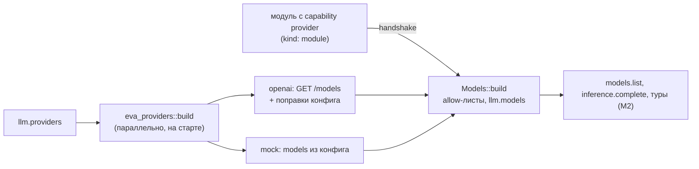

# Провайдеры

Инференс ядра идёт через трейт `Provider` (`core/src/provider.rs`): `decl()`, `models()`, `generate()` (поток `GenItem`), `embed()`, `count_tokens()`. Реализации вендоров живут только в `providers/*`; остальной код ядра не знает ни одной vendor-строки (это проверяет тест, см. [Разработка](development.md#vendor-lint)).

| Крейт | `kind` | Назначение |
|---|---|---|
| `eva-provider-openai` | `openai` | OpenAI-совместимый Chat Completions: OpenRouter (диалект `openrouter`), vLLM, llama-server, OpenAI (диалект `plain`) |
| `eva-provider-mock` | `mock` | сценарный провайдер для тестов и смоука без ключей |
| `eva-providers` | — | `ProviderConfig` под тегом `kind`, `AnyProvider`, `build` |
| ядро | `module` | провайдер — подключённый модуль с capability `provider` |

## Реестр моделей



- На старте ядро параллельно собирает все встроенные провайдеры из `llm.providers`; ошибка сборки любого из них валит старт с путём записи (`llm.providers.<name>: <причина>`).
- Реестр — объединение `Provider::models()` всех провайдеров. Модель принимается, если проходит allow-list своего провайдера и глобальный `llm.models`.
- Совпадение имён среди встроенных: провайдеры обходятся по алфавиту имён в `llm.providers`, первая декларация имени побеждает; остальные отбрасываются с предупреждением `model is not registered`.
- Модуль-провайдер добавляется поверх текущего реестра: имя модели, которое уже кто-то обслуживает, он не перехватит ни порядком имён, ни реконнектом.
- Реестр — неизменяемый снимок: запрос читает его без блокировок, изменение заменяет снимок целиком.
- `llm.default_model`, которой нет в реестре на старте, — предупреждение, не ошибка.

Декларация модели (`ModelDecl`, видна клиентам через `models.list`):

| Поле | Смысл |
|---|---|
| `name` | id модели, уникален в реестре |
| `context_window` | окно в токенах |
| `max_output` | потолок ответа в токенах |
| `caps` | нативные возможности (ниже) |
| `price` | `{input, output, cache_read, cache_write_short, cache_write_long}` за миллион токенов в валюте `llm.currency`; null — цены нет |
| `embed` | `{dims, max_input_tokens}` у эмбеддинговых моделей |

`ModelCaps`: `vision`, `image_out`, `thinking`, `effort_levels`, `structured_output`, `system_in_messages`, `tool_changes`, `clear_at`, `effort_in_messages`, `context_editing`, `server_compaction`, `thinking_binding`, `cache_breakpoints` (0 — кэша нет), `cache_keep_alive`, `cache_min_prefix` (0 — неизвестен). Флаг описывает нативную форму; при `false` запасной путь выбирает ядро, не провайдер.

`ProviderDecl`: `local` — инференс на машине ядра; с M3 только такому эмбеддеру ядро будет отдавать приватный текст (в M1 ядро флаг лишь хранит в реестре); `count_tokens` — провайдер умеет точно считать токены, иначе ядро пользуется калиброванной оценкой.

## Провайдер `openai`

```yaml
llm:
  providers:
    router:
      kind: openai
      api_key: {file: /run/credentials/eva-kernel.service/router}
      allow: [vendor/model-a, vendor/model-b]
      models:
        vendor/model-a:
          caps: {effort_levels: [low, medium, high, max]}
    local:
      kind: openai
      base_url: http://127.0.0.1:8080/v1
      dialect: plain
      models:
        qwen:
          context_window: 32768
          max_output: 8192
          caps: {thinking: true}
        embed:
          embed: {dims: 1024, max_input_tokens: 8192}
```

### Ключи

| Ключ | Тип | По умолчанию | Смысл |
|---|---|---|---|
| `base_url` | строка | `https://openrouter.ai/api/v1` | корень API без `/chat/completions`; запросы — `<base_url>/models`, `/chat/completions`, `/embeddings` |
| `api_key` | `{plaintext}` \| `{file}` \| null | null | ключ для `Authorization: Bearer`; файл читается при сборке, хвостовой перевод строки срезается. Секрет — см. [Конфигурация](config.md#секреты) |
| `proxy` | строка \| null | null | `http://`, `https://` или `socks5://` |
| `timeout` | длительность | `5m` | потолок подключения и тишины между чтениями, не всего ответа: длинная генерация не рвётся |
| `dialect` | `openrouter` \| `plain` | `openrouter` | набор расширений запроса (ниже) |
| `allow` | список id \| null | null — всё | allow-list моделей провайдера |
| `models` | `{id: поправка}` | `{}` | поправки к каталогу; для сервера без каталога — единственный источник моделей |
| `referer` | строка \| null | null | заголовок `HTTP-Referer` (атрибуция приложения у OpenRouter) |
| `title` | строка \| null | null | заголовок `X-Title` |

### Диалекты

| | `openrouter` | `plain` |
|---|---|---|
| Для чего | OpenRouter | vLLM, llama-server, OpenAI |
| Размышление | `reasoning: {effort \| enabled}` | `reasoning_effort` |
| Реплей мыслей | `reasoning_details` своей модели | нет |
| Кэш промпта | `cache_control` на breakpoint'ах | нет (`cache_breakpoints = 0`) |
| Учёт стоимости | `usage: {include: true}`, `usage.cost` | нет |
| System | массив текстовых частей, по одной на секцию | одна строка, секции через пустую строку |
| Нет каталога `GET /models` | см. «Каталог моделей» | допустимо: модели только из `models` |
| Картинки в assistant-сообщениях | реплеятся у моделей с `image_out` | отбрасываются |

### Каталог моделей

При сборке провайдер один раз читает `GET <base_url>/models` (таймаут 30 с) и строит декларации:

1. Множество имён: `allow`, если задан; иначе все `id` каталога плюс ключи `models`.
2. Имя без записи в каталоге и без поправки пропускается с предупреждением.
3. Поле декларации берётся из поправки, иначе из каталога:

| Поле `ModelDecl` | Источник в каталоге | Если нет |
|---|---|---|
| `context_window` | `context_length`, затем `top_provider.context_length`, затем `max_model_len` (vLLM) | `embed.max_input_tokens`; иначе модель пропускается: `context_window is unknown, set it in config` |
| `max_output` | `top_provider.max_completion_tokens` | `context_window`; у эмбеддера — 0 |
| `price.input` / `price.output` | `pricing.prompt` / `pricing.completion` (за токен, строкой) × 10⁶ | нет любой из двух — цены нет; отрицательная цена (переменная у роутеров) — цены нет |
| `price.cache_read` | `pricing.input_cache_read` | `price.input` |
| `price.cache_write_short` | `pricing.input_cache_write` | `price.input` |
| `price.cache_write_long` | — | семейство `anthropic/*` — `2 × price.input`; иначе `cache_write_short` |
| `caps.vision` | `architecture.input_modalities` содержит `image` | `false` |
| `caps.image_out` | `architecture.output_modalities` содержит `image` | `false` |
| `caps.thinking` | `supported_parameters` содержит `reasoning` или `include_reasoning` | `false` |
| `caps.effort_levels` | — | `[low, medium, high]` при `thinking`, иначе `[]` |
| `caps.structured_output` | `supported_parameters` содержит `structured_outputs` или `response_format` | `false` |
| `embed` | — (каталог эмбеддеров не описывает) | только из поправки |

Цена за токен переводится в цену за миллион сдвигом запятой в строке, без погрешности float.

Недоступный каталог:

| Ситуация | Поведение |
|---|---|
| Любая ошибка, кроме `auth`/`not_found`/`invalid` (сеть, таймаут, 5xx, 408/429/402, не-JSON ответ) | провайдер стартует с моделями из `models`, каталог помечается недочитанным; `AnyProvider::settle` дочитывает его повторами с паузой от 5 с, удваивая до 5 мин. Ядро запускает `settle` каждого встроенного провайдера в фоне сразу после старта и, когда каталог прочитан, пересобирает модели этого провайдера в работающем реестре без перезапуска (`provider models reloaded` в логе) |
| Окончательный отказ (`auth`, `not_found`, `invalid`), диалект `plain` | предупреждение, модели только из `models` |
| Окончательный отказ, диалект `openrouter` | ошибка сборки: неверный ключ или путь валят старт ядра |

`ProviderDecl.local` — `true`, если хост `base_url` — `localhost` или loopback-адрес; `count_tokens` — всегда `false`.

### Поправки `models.<id>`

Неизвестные ключи в поправке и в её `caps` — ошибка разбора конфига.

| Ключ | Тип | Смысл |
|---|---|---|
| `context_window` | u32 | окно; обязателен для модели, которой нет в каталоге (если это не эмбеддер) |
| `max_output` | u32 | потолок ответа |
| `price` | `{input, output, cache_read, cache_write_short, cache_write_long}` | цена за MTok, заменяет цену каталога целиком |
| `embed` | `{dims, max_input_tokens}` | делает модель эмбеддером (`POST /embeddings`) |
| `caps.vision` | bool | |
| `caps.image_out` | bool | включает запрос `modalities: ["image", "text"]` |
| `caps.thinking` | bool | |
| `caps.effort_levels` | список `Effort` | `max` в списке — уровень `max` уходит как `xhigh` |
| `caps.structured_output` | bool | |
| `caps.system_in_messages` | bool | system-сообщения посреди диалога; по умолчанию `false` |
| `caps.thinking_binding` | bool | подпись мыслей привязана к набору тулов; по умолчанию `true` у `anthropic/*` под `openrouter` |
| `caps.cache_breakpoints` | u8 | только `openrouter`; у `plain` всегда 0 |
| `caps.cache_min_prefix` | u32 | минимальный кэшируемый префикс в токенах |

`tool_changes`, `clear_at`, `effort_in_messages`, `context_editing`, `server_compaction`, `cache_keep_alive` у Chat Completions нативной формы не имеют и всегда `false`; поправкой не задаются.

### Кэш промпта

Только диалект `openrouter`. Значения по умолчанию по семейству (префикс id модели):

| Семейство | `cache_breakpoints` | `cache_min_prefix` |
|---|---|---|
| `anthropic/*` | 4 | 1024 |
| `google/gemini*` | 4 | 1024 |
| `openai/*` | 0 (кэш автоматический) | 1024 |
| прочие | 0 | 0 |

- Breakpoint — позиция запроса (system или сообщение с индексом). На него ставится `cache_control`: `{type: ephemeral}` при `cache: short`, `{type: ephemeral, ttl: "1h"}` при `cache: long`; при `cache: off` маркеров нет.
- Маркер вешается только на текстовую часть; сообщение без текста (только вызовы тулов) breakpoint не несёт.
- Больше breakpoint'ов, чем `cache_breakpoints`, повтор позиции или индекс вне списка сообщений — ошибка `invalid` до отправки.
- Сообщения рендерятся независимо от соседей: префикс лога даёт тот же префикс `messages` (кроме маркера хвостового breakpoint'а), поэтому кэш не ломается от дописывания хвоста.
- Учёт: `input` = `prompt_tokens` − прочитанное − записанное; `cache_read` — `prompt_tokens_details.cached_tokens`; запись (`cache_write_tokens`) целиком относится к TTL запроса — `cache_write_long` при `long`, иначе `cache_write_short`.

### Размышление и effort

Параметры уходят, только если у модели `caps.thinking`.

| Диалект | `thinking` | `effort` | Тело запроса |
|---|---|---|---|
| `openrouter` | `off` | любой | `reasoning: {enabled: false}` |
| `openrouter` | не `off` | задан | `reasoning: {effort: <уровень>}` |
| `openrouter` | `adaptive` | не задан | `reasoning: {enabled: true}` |
| `plain` | не `off` | задан | `reasoning_effort: <уровень>` |
| — | прочие сочетания | | ничего |

Уровни: `low`, `medium`, `high` — как есть; `max` — `xhigh`, если `max` есть в `effort_levels` модели, иначе `high`.

Разбор ответа:

- `delta.reasoning_details` (OpenRouter) склеиваются по `type` и `index` в элементы; каждый элемент уходит ядру целиком JSON'ом (`ThinkingBlock`, для `reasoning.encrypted` — `RedactedThinking`) и реплеится байт-в-байт в следующих запросах — только той же модели и только под `openrouter`.
- `delta.reasoning` / `delta.reasoning_content` — текст мыслей, если `reasoning_details` нет.
- Инлайн `<think>…</think>` в `content` (локальные серверы) выделяется в мысли, в том числе когда тег разрезан между чанками.

### Картинки

**На входе.**

- Блок `Image` user-сообщения уходит частью `image_url` с data URL `data:<mime>;base64,…`.
- Картинки из результатов тулов: сообщение `role: tool` картинок не несёт, поэтому они уходят следом, в одном user-сообщении вместе с остальным текстом и картинками этого хода.
- Картинки в assistant-сообщениях отправляются только под `openrouter` и только модели с `image_out`; иначе отбрасываются.
- Провайдер не проверяет `vision`: решение, слать ли байты модели без зрения, принимает ядро.

**На выходе.**

- Модели с `caps.image_out` в запрос добавляется `modalities: ["image", "text"]`.
- `delta.images[].image_url.url` с data URL превращается в `GenItem::Image {media_type, data}`.
- Картинка не data URL пропускается с предупреждением; текст ответа при этом не теряется.

**Ядро в M1.** Картинки уже работают в `inference.complete`:

- Блок `Image` входа (ссылка на blob из `blobs.put`) уходит байтами, если у модели `vision`; иначе — текстовым маркером `[image <blob>] <name>`.
- Блок `File` всегда уходит маркером `[file <blob>] <name> (<size> bytes)`.
- Ответ `inference.complete` — только текст (и JSON по схеме): сгенерированные моделью картинки в нём не возвращаются.

Полноценный диалог с картинками — туры — появится в M2.

### Прочее в запросе

- Всегда `stream: true` и `stream_options: {include_usage: true}`; `max_tokens` — если больше 0.
- Тулы — `type: function`; отложенные (`deferred`) не отправляются: в Chat Completions нет `defer_loading`.
- В JSON Schema тулов и формата ответа `oneOf` переписывается в `anyOf`: часть строгих валидаторов `oneOf` не принимает.
- Структурированный ответ — `response_format: {type: json_schema, json_schema: {name: output, strict, schema}}`, только при `caps.structured_output`; иначе формат опускается.
- Запрос `keep_alive` отклоняется: в Chat Completions нет `cache_keep_alive`.
- Аргументы вызова тула, оказавшиеся невалидным JSON, сохраняются строкой и уходят модели теми же байтами. Вызов без `id` получает `call_<index>`.
- Причины остановки: `stop` → `end_turn`, `tool_calls`/`function_call` → `tool_use`, `length` → `max_tokens`, `content_filter` → `refusal`, иное → `other` с исходной строкой. Поле `delta.refusal` превращает `end_turn` в `refusal`.
- Остатки лимитов `x-ratelimit-remaining-requests`/`-tokens` попадают в `Usage.rate_limits`, если сервер их шлёт; стоимость — из `usage.cost`.

### Классификация ошибок

Вид ошибки (`ProviderErrorKind`) определяется HTTP-статусом; текст смотрится только там, где статус неоднозначен.

| Условие | Вид |
|---|---|
| 408, 429, 5xx | `transient` |
| 401 | `auth` |
| 402 | `quota` |
| 403 с `error.metadata.reasons` или `flagged_input` (модерация) | `content_filter` |
| 403 прочий | `auth` |
| 404 | `not_found` |
| прочий 4xx с признаком переполнения окна | `overflow` |
| прочий 4xx | `invalid` |
| сбой сети или таймаут до ответа | `transient` |
| ошибка построения запроса | `invalid` |
| кадр `{"error": …}` посреди стрима | по числовому `error.code` как статус; без кода — `overflow` по признаку, иначе `other` |
| поток кончился без `finish_reason` | `other` |

Признак переполнения: `error.code = context_length_exceeded` или одна из фраз `context_length_exceeded`, `context length`, `context limit`, `context window`, `context size`, `prompt is too long`, `prompt too long` в `error.message` либо `error.metadata.raw` (туда OpenRouter кладёт ответ апстрима).

`retry_after` берётся из заголовка `Retry-After` (только секунды, потолок 1 ч) и сохраняется лишь для `transient` и `quota`. `raw` — тело ответа как есть.

Реакция ядра на вид ошибки — повторы (`llm.retries`, `llm.retry_backoff`), цепочка `llm.fallback`, компакция при `overflow` — часть движка туров (M2). В M1 `inference.complete` возвращает ошибку провайдера модулю как есть и считает её в счётчике здоровья `inference.errors`.

## Провайдер `mock`

Сценарный провайдер без сети: для тестов ядра и смоук-запусков без ключей.

| Ключ | Тип | По умолчанию | Смысл |
|---|---|---|---|
| `models` | список `ModelDecl` | `mock` и `mock-embed` (ниже) | полные декларации моделей; пустой список — провайдер без моделей |
| `decl` | `{local, count_tokens}` | `{local: true, count_tokens: true}` | декларация провайдера |
| `on_exhausted` | `echo` \| `fail` | `echo` | ответ на запрос сверх заготовленных сценариев |

Модели по умолчанию:

| Модель | `context_window` | `max_output` | Возможности |
|---|---|---|---|
| `mock` | 200000 | 32000 | `vision`, `thinking`, `effort_levels: [low, medium, high, max]`, `structured_output` |
| `mock-embed` | 8192 | 0 | `embed: {dims: 64, max_input_tokens: 8192}` |

Поведение:

- **Эхо.** Без сценария ответ — `[mock:<model>] echo: <текст последней user-реплики>`, нарезанный по словам (стрим виден клиенту). При заданном формате ответа — минимальный валидный образец по JSON Schema: `const`/`enum` — первое значение, объект — только обязательные поля, массив пуст, скаляры — нули.
- **`fail`.** Запрос сверх сценариев — ошибка `invalid`: лишний шаг не прячется за эхом.
- **Сценарии.** Задаются только из Rust (`MockProvider::push`): последовательность `GenItem` (текст, мысли, вызовы тулов, usage, stop), «ворота», держащие поток до сигнала теста, и завершение ошибкой, в том числе после дельт — обрыв посреди ответа. Сценарии расходуются по одному на `generate`.
- **Запись.** Все запросы `generate`, включая отвергнутые, доступны тесту (`requests()`, `last_request()`, счётчик `seen()`).
- **Эмбеддинги.** Детерминированные единичные векторы из хэша текста: одинаковый вход — одинаковый вектор на любой сборке.
- **Подсчёт токенов.** Байты текста / 4 с округлением вверх; картинки не считаются.
- **Валидация.** Запрос, на который живой вендор ответил бы 400, отвергается `invalid` — баги рендера ядра валят любой тест через мок:
  - пустой system-промпт, нет сообщений, последнее сообщение — assistant;
  - дубли имён тулов; отложенный тул у модели без `tool_changes`;
  - `tool_result` без `tool_use` в непосредственно предыдущем сообщении, `tool_use` без `tool_result` в следующем, дубли id;
  - `tool_use`/мысли в user-сообщении, `tool_result` в assistant-сообщении, реплей мыслей без подписи;
  - system-сообщение у модели без `system_in_messages`, первым, сразу после assistant или перед user; `clear_at`/`output_config`/`tool_changes` без соответствующих флагов; не-текстовый блок в system;
  - картинка (в том числе в результате тула) у модели без `vision`;
  - breakpoint'ов больше `cache_breakpoints`, повтор, индекс вне диапазона;
  - запрос `keep_alive` у модели без `cache_keep_alive`.

## `kind: module`

Запасной вход: провайдером становится модуль, подключённый по RPC (см. [Протокол модулей](protocol.md) и [SDK](sdk.md)).

```yaml
llm:
  providers:
    gpu-box: {kind: module, allow: [local-model]}
```

- Имя записи в `llm.providers` — id модуля, то есть ключ его записи реестра сервисов. Capability `provider` принимается только у модуля, названного здесь с `kind: module`: провайдер видит полный транскрипт, включая приватную память. Иначе capability отбрасывается с предупреждением `forbidden` в `welcome`, сессия живёт.
- Модуль объявляет в `hello` `ProviderCap {decl, models}`; модели проходят `allow` (null — все объявленные) и `llm.models`, имена, уже занятые другим провайдером, отклоняются. Принятые перечисляются в `welcome.models_accepted`, отклонённые — в `warnings` (`forbidden` — не прошла allow-list, `conflict` — имя занято).
- Провайдер встаёт в реестр при старте сессии, если принята хотя бы одна модель, и несёт только принятые модели; при закрытии или вытеснении сессии он и его модели уходят из реестра.
- Вызовы ядра к модулю: `provider.generate` (поток `GenItem`), `provider.embed`, `provider.count_tokens`. Ошибка передаётся как `ProviderError` в `data` ошибки RPC и считается в счётчике здоровья `modules.rpc_errors` с именем модуля.
